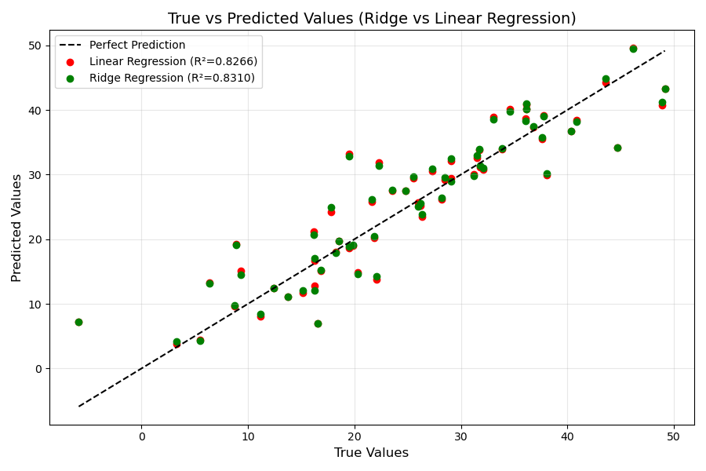
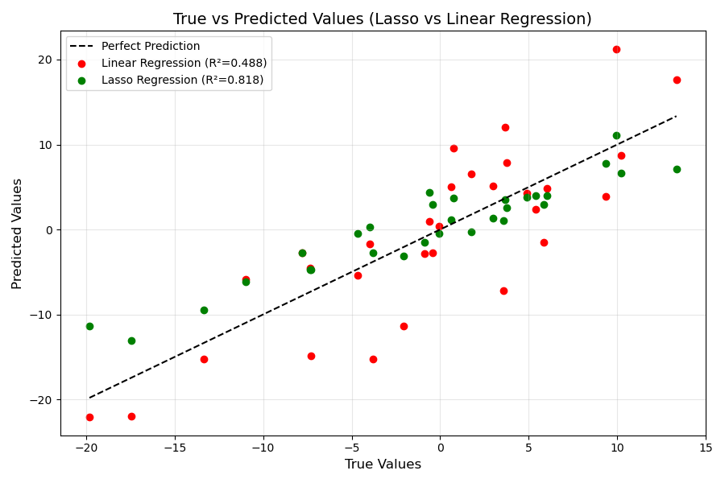
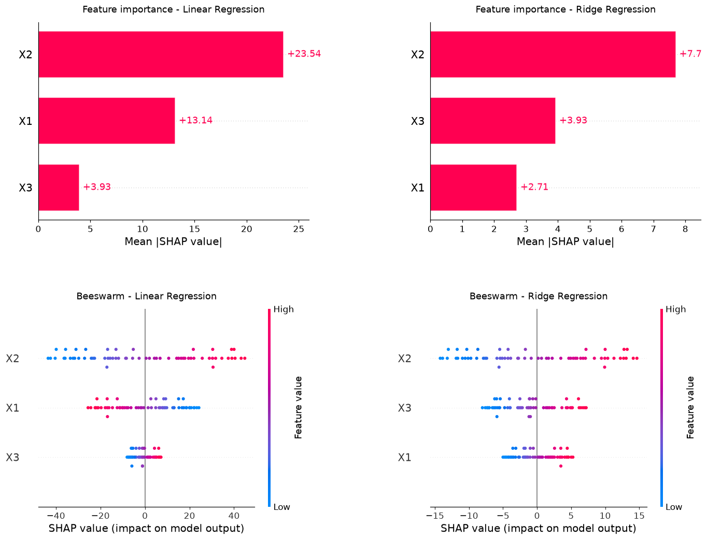
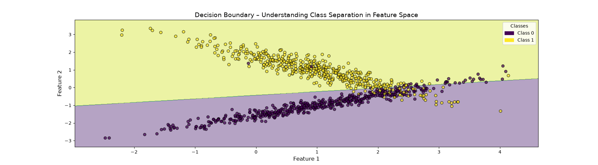
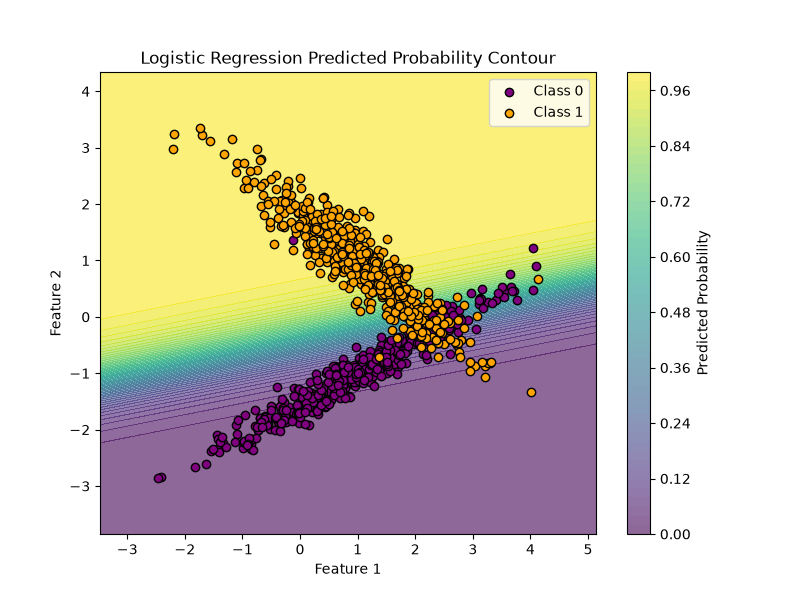
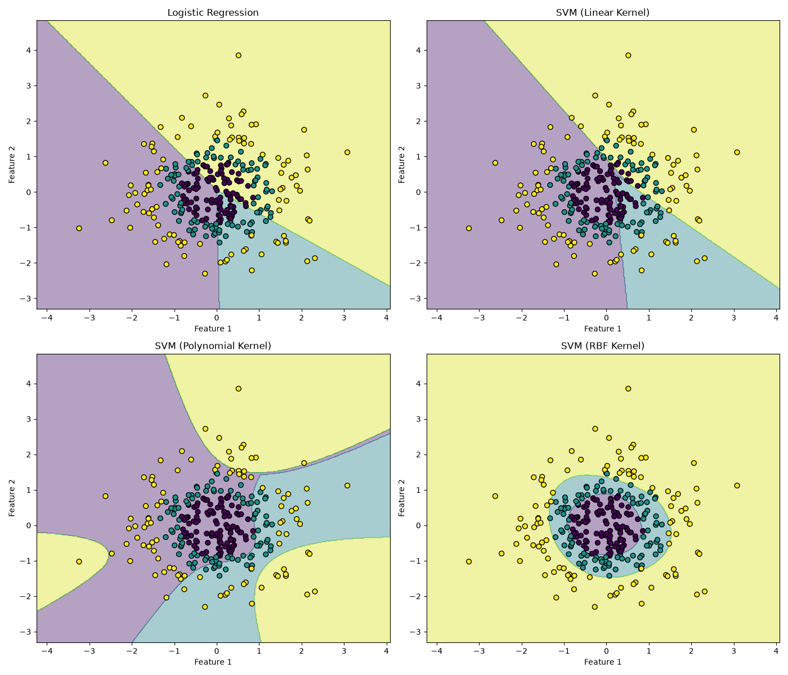

# Linear Models

Python linear models project for the Holberton School Modern AI curriculum.

## Description

This project builds the linear family of supervised learning models with
`scikit-learn`, one small factory function per model, and uses them to
show what regularization actually buys you.

Each task returns an **untrained** estimator. The test files do the
fitting, so the same model definition can be pointed at different data
and the effect of a single change — an L2 penalty, an L1 penalty, a
different kernel — can be read straight off the results.

The project moves through three stages:

- **Regression** — fit a line with ordinary least squares, measure its
  error, then add the Ridge and Lasso penalties to handle correlated
  features and irrelevant ones
- **Explainability** — attribute each prediction back to the features
  that drove it with SHAP values
- **Classification** — move from predicting a number to predicting a
  class, with logistic regression and support vector machines

## Requirements

- Ubuntu 20.04 LTS, Python 3.11
- `numpy`, `scikit-learn`, `shap`, `matplotlib`
- Code follows `pycodestyle` 2.11.1
- All files are executable and start with `#!/usr/bin/env python3`
- All modules and functions are documented
- Each task may only import the module its specification allows

## Tasks

### Regression

| File                                 | Function                                             | Description                                                            |
| ------------------------------------ | ---------------------------------------------------- | ---------------------------------------------------------------------- |
| `0-linear_regression.py`             | `Linear_Regression()`                                | Ordinary least squares regression, the unregularized baseline          |
| `1-regression_evaluation_metrics.py` | `evaluation_metrics_for_regression(y_true, y_pred)`  | Compute MSE, RMSE, MAE and R² for a model's predictions                |
| `2-ridge_regression.py`              | `ridge_regression(random_state)`                     | Ridge regression, whose L2 penalty shrinks large coefficients          |
| `3-Lasso_regression.py`              | `lasso_regression(random_state)`                     | Lasso regression, whose L1 penalty zeroes coefficients outright        |

### Explainability

| File                                 | Function                                             | Description                                                            |
| ------------------------------------ | ---------------------------------------------------- | ---------------------------------------------------------------------- |
| `4-shap.py`                          | `get_shap_explainer_and_values(model, X_train, X_test)` | Build a SHAP explainer and compute SHAP values for a trained model  |

### Classification

| File                                 | Function                                             | Description                                                            |
| ------------------------------------ | ---------------------------------------------------- | ---------------------------------------------------------------------- |
| `5-logisitc_regression.py`           | `Logistic_Regression_Model(random_state)`            | Logistic regression for binary classification                          |
| `6-svm.py`                           | `get_SVM_model(name, random_state)`                  | Support vector classifier with a `linear`, `poly` or `rbf` kernel      |

## What the results show

Each test file generates synthetic data chosen to expose one specific
weakness, so the comparison is the point rather than the raw score.

**Ridge against correlated features.** Tasks 0–2 fit
`y = 4·X1 + 3·X3 + noise`, where `X2` is a near-copy of `X1`. OLS cannot
tell `X1` and `X2` apart and splits enormous opposing weights across the
pair; Ridge keeps them bounded and lands close to the true coefficients.

| Model             | Coefficients for `[X1, X2, X3]` | R²     |
| ----------------- | ------------------------------- | ------ |
| Linear regression | `[-5.08,  9.10,  3.08]`         | 0.8266 |
| Ridge regression  | `[ 1.05,  2.98,  3.08]`         | 0.8310 |



The two models are almost indistinguishable in the plot — the red and
green points sit on top of each other. That is the lesson: R² barely
moves, so accuracy alone hides the problem. The coefficients are where
the instability shows, and unstable coefficients mean the model cannot
be interpreted or trusted on new data.

**Lasso against irrelevant features.** Task 3 uses 50 features of which
only 5 matter, and just 100 samples. OLS has no way to ignore the other
45 and overfits them; Lasso drives their coefficients to exactly zero.

| Model             | Features used | R²     |
| ----------------- | ------------- | ------ |
| Linear regression | 50 / 50       | 0.4885 |
| Lasso regression  | 6 / 50        | 0.8185 |



Here the gap is visible. The green Lasso points track the diagonal
closely; the red OLS points scatter far from it, especially at the
extremes, because the model fit noise in the 45 useless features.

**SHAP confirms the diagnosis.** Task 4 explains the task 0–2 models.
Mean absolute SHAP value per feature:

| Model             | `X1`  | `X2`  | `X3` |
| ----------------- | ----- | ----- | ---- |
| Linear regression | 13.14 | 23.54 | 3.93 |
| Ridge regression  |  2.71 |  7.70 | 3.93 |



OLS leans on the collinear pair an order of magnitude harder than Ridge
does, while both agree exactly on `X3`. The penalty changed only the part
of the model that was unstable.

Note the x-axis scales differ between the two columns — OLS runs to 25,
Ridge to 8. The beeswarm plots below them show the per-sample spread
behind those averages, coloured by feature value.

**Logistic regression draws one straight line.** Task 5 separates two
well-behaved classes and reaches 0.88 accuracy. The decision boundary is
a single straight cut through the feature space:



What makes it a *probability* model rather than a bare classifier is
what sits either side of that cut. `predict_proba` returns a confidence
that slides smoothly from 0 to 1, steeply near the boundary and flatly
far from it:



**Kernels decide what a classifier can separate.** Task 6 classifies
three concentric Gaussian rings, which no straight line can divide.
Accuracy on the held-out set:

| Model                        | Accuracy |
| ---------------------------- | -------- |
| Logistic regression          | 0.27     |
| SVM, linear kernel           | 0.37     |
| SVM, polynomial kernel       | 0.45     |
| SVM, RBF kernel              | 0.95     |



Chance is 0.33 for three balanced classes, so every linear boundary here
is near useless no matter how it is fitted. The plot shows why: logistic
regression and the linear kernel can only cut the plane with straight
lines, the polynomial kernel bends them into hyperbolas that still miss,
and only the RBF kernel wraps its boundary into the concentric rings the
data is actually made of.

## Usage

Each task has at least one matching test file. Run one from this
directory:

```bash
./6-main.py
```

| Task | Test files                       | Saves                            |
| ---- | -------------------------------- | -------------------------------- |
| 0    | `0-main.py`                      | —                                |
| 1    | `1-main.py`                      | —                                |
| 2    | `2-main.py`                      | `2_main.png`                     |
| 3    | `3-main.py`                      | `3_main.png`                     |
| 4    | `4-main_1.py`                    | `4_main_1.png`                   |
| 5    | `5-main_1.py`, `5-main_2.py`     | `5_main_1.png`, `5_main_2.png`   |
| 6    | `6-main.py`                      | `6_main.png`                     |

The test files and the `.png` files they write to this directory are
scaffolding rather than deliverables. The figures shown in this README
are kept separately in `images/`, so the generated ones can be ignored:

```
*-main*.py
[0-9]*_main*.png
```

### Environment note

`shap` requires NumPy 2, which is newer than the `matplotlib` packaged
for Ubuntu. If an import fails with
`numpy.core.multiarray failed to import`, install both into a virtual
environment rather than mixing system and pip packages:

```bash
python3 -m venv .venv
source .venv/bin/activate
pip install numpy scipy scikit-learn matplotlib shap
```
